<p align="center">
  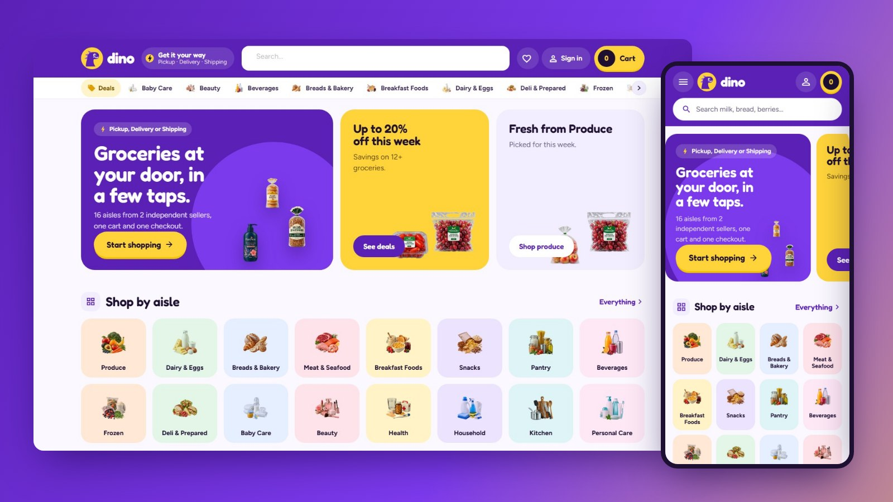
</p>

<h1 align="center">Dino Market</h1>

<p align="center">
  <b>A purple, playful quick-delivery grocery app on the web, for a Selldone marketplace.</b><br>
  A custom Selldone Layout built on the official <a href="https://github.com/selldone/storefront">selldone/storefront</a>.
</p>

<p align="center">
  <a href="https://dino.selldone.shop"></a>
  <a href="https://github.com/selldone-custom-layouts/official-dino/wiki"></a>
  <a href="https://github.com/selldone-custom-layouts/official-dino/wiki/Install-with-AI"></a>
  
  
</p>

<p align="center">
  <a href="https://dino.selldone.shop"><b>Open the live shop</b></a> ·
  <a href="https://github.com/selldone-custom-layouts/official-dino/wiki/Install-with-AI">Set it up with AI</a> ·
  <a href="https://github.com/selldone-custom-layouts/official-dino/wiki/Manual-Setup">Manual setup</a> ·
  <a href="https://github.com/selldone-custom-layouts/official-dino/wiki/Shop-Requirements">What your shop needs</a> ·
  <a href="https://github.com/selldone-custom-layouts">All Selldone custom layouts</a>
</p>

---

## What it is

**Dino Market** dresses a grocery marketplace as a quick-delivery app:
- deep violet for every action and sunny yellow for the one thing to press;
- lavender under every packshot, big rounded corners and pills everywhere;
- Fredoka headings and prices, Figtree text;
- a friendly violet dinosaur on a yellow disc as the mark, on About, sign-in and the 404.

It runs on **[dino.selldone.shop](https://dino.selldone.shop)**, one address of the Selldone shop molino. The shop's main address carries [Molino Market Hall](https://github.com/selldone-custom-layouts/official-molino); other addresses carry [Tario](https://github.com/selldone-custom-layouts/official-tario), [Walio](https://github.com/selldone-custom-layouts/official-walio) and Valero. Selldone lets each domain of a shop carry its own Layout.

Selldone's own basket, checkout, payments, vendor offers and orders keep working underneath. Nothing about the shop is hard-coded.

## Highlights

- **Header:** a violet bar with the dinosaur, a **Get it your way** pill naming the shop's own delivery methods, a big rounded search, round icon buttons and a **yellow cart pill with the count and the total**. Under it, a white strip of aisles, each with its icon, Deals first.
- **Home:** three rounded promo cards (swiped on a phone), **the aisles as a tile grid**, **today's deals with a countdown to midnight**, the fresh aisle, the sellers as round avatars with four of their groceries, top picks, and how the order reaches you.
- **Cards:** the packshot large on a lavender square, a yellow saving pill, and a **round yellow "+" on the picture** that turns into a violet "− n +" in place; "Options" for products with sizes; the seller is named under the card.
- **Aisle, search, Deals, All products:** a sticky column with **every aisle and its icon**, then the filters; the aisle's banner with its icon and numbers; on a phone the aisles become a row of icon tiles you swipe.
- **Product page:** a rounded picture stage, a brand pill, the price in violet with a yellow saving pill, the delivery methods and the sellers as rounded choice cards, a big yellow **Add to cart**, pill tabs for the details.
- **Cart:** a **rounded sheet from the right** on every screen, with a **free-shipping progress bar** in its violet head.
- **Checkout:** step chips (done in yellow, current in violet), rounded cards, a lavender summary and a yellow pay button; a map-first address sheet.
- **Seller pages:** a **violet banner** with the seller's mark in a yellow ring, live numbers as pills and their aisles as chips.
- **Account:** a violet banner with the sections as pills, the overview's tiles in pastel colours, orders as rounded cards.
- **Pages:** About with the dinosaur and the shop's live numbers, Terms and Privacy with the short version on pastel cards, the journal on rounded cards, and a 404 where the dinosaur asks "?".
- **Everywhere:** no pop-ups and no phone bottom bar.

## Screenshots

| | Desktop | Phone |
| --- | --- | --- |
| Home | 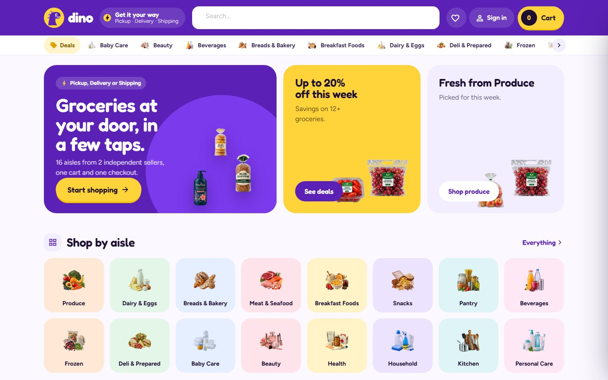 | 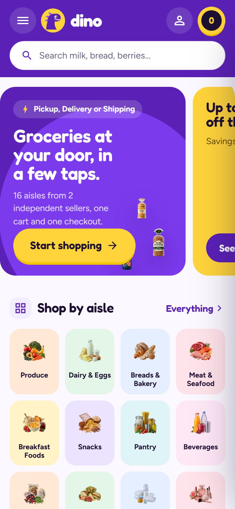 |
| Aisle | 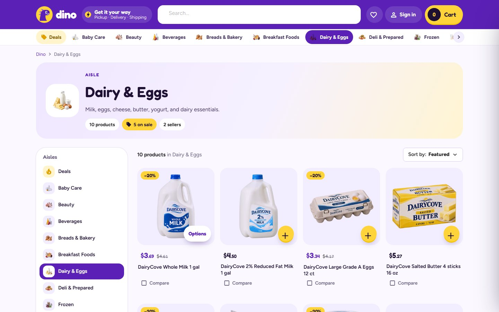 | 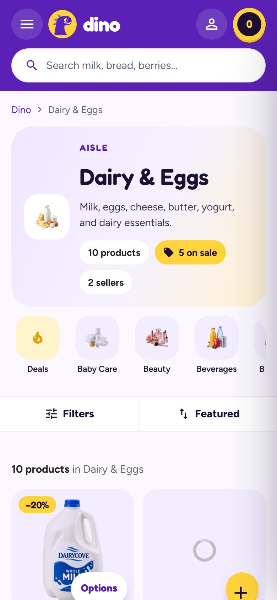 |
| Product | 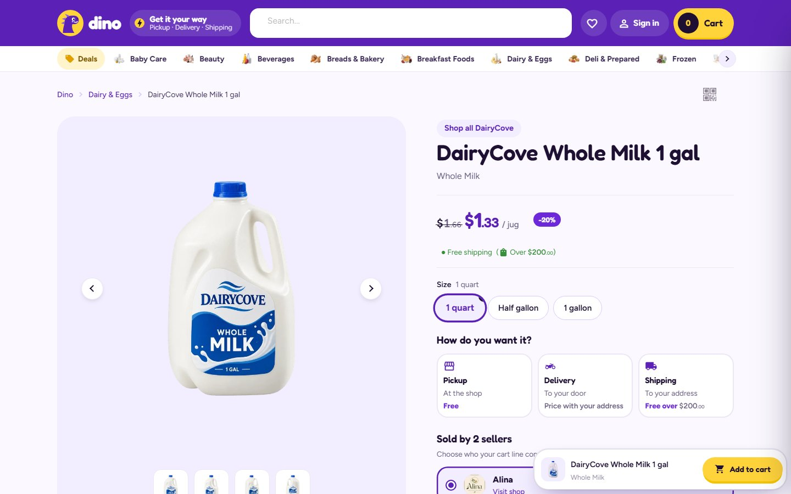 | 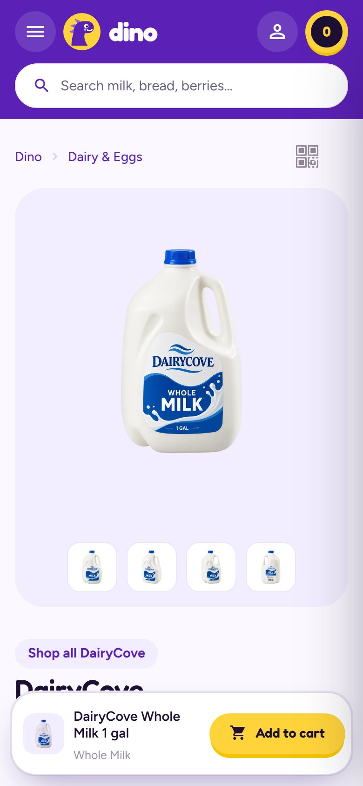 |
| Cart | 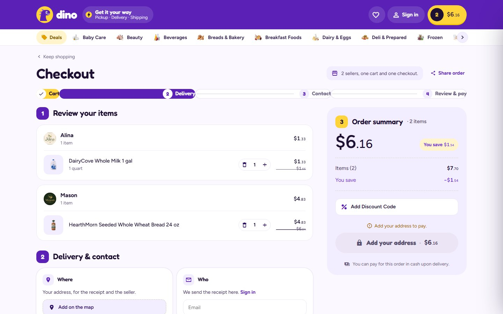 | 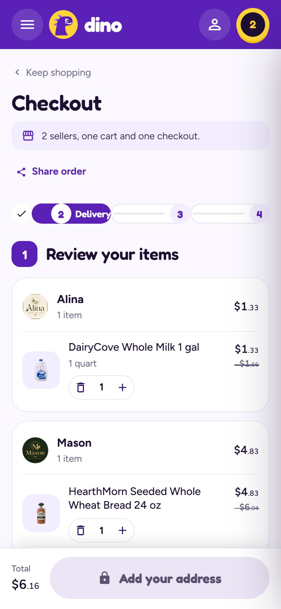 |
| Seller | 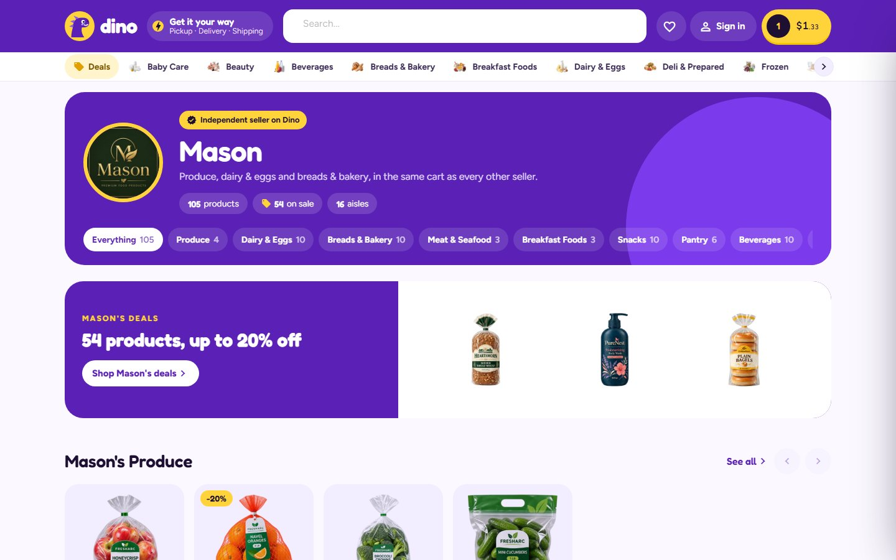 | 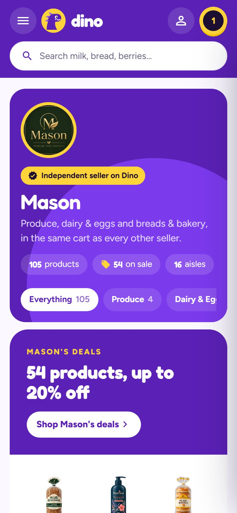 |

## Use it on your shop

| You want to… | Read |
| --- | --- |
| Let an AI agent (Claude Code, Codex…) set it up for your shop | [Install with AI](https://github.com/selldone-custom-layouts/official-dino/wiki/Install-with-AI) |
| Do it yourself, step by step | [Manual Setup](https://github.com/selldone-custom-layouts/official-dino/wiki/Manual-Setup) |
| Know what data your shop needs for the design to look right | [Shop Requirements](https://github.com/selldone-custom-layouts/official-dino/wiki/Shop-Requirements) |
| Build, upload and verify a release | [Build and Upload](https://github.com/selldone-custom-layouts/official-dino/wiki/Build-and-Upload) |
| Put the Layout live on your shop, or on one domain of it | [Go Live](https://github.com/selldone-custom-layouts/official-dino/wiki/Go-Live) |
| Change colours, fonts, sections or pages | [Customize](https://github.com/selldone-custom-layouts/official-dino/wiki/Customize) |
| Fix a blank page, a rejected upload or an old version showing | [Troubleshooting](https://github.com/selldone-custom-layouts/official-dino/wiki/Troubleshooting) |

The wiki's source is also in [`docs/wiki/`](docs/wiki/).

## Quick start (developers)

```bash
git clone --recurse-submodules https://github.com/selldone-custom-layouts/official-dino.git
cd official-dino
npm install --force
npm run serve            # dev server on http://localhost:9127
```

Releases: `bash scripts/release.sh <new-version> home`. See [Build and Upload](https://github.com/selldone-custom-layouts/official-dino/wiki/Build-and-Upload).

## Where things are

| Area | Files |
| --- | --- |
| Dino's dress: the violet bar, aisle strip, cart sheet, footer, checkout steps | [`style/dino-skin.scss`](style/dino-skin.scss) |
| The home, rows and the app card | [`components/dino/`](components/dino/), [`style/dino-home.scss`](style/dino-home.scss) |
| Design C over every other page | [`style/dino-c.scss`](style/dino-c.scss), [`style/dino-c-pages.scss`](style/dino-c-pages.scss) |
| Tokens: violet, yellow, lavender, Fredoka and Figtree, radii | [`style/kalio-tokens.scss`](style/kalio-tokens.scss), [`components/kalio/kalio-fonts.ts`](components/kalio/kalio-fonts.ts) |
| Name and mark | [`components/kalio/kalio-brand.ts`](components/kalio/kalio-brand.ts), [`assets/brand/dino-mark.svg`](assets/brand/dino-mark.svg) |
| What Dino changed, and why | [`DINO.md`](DINO.md) |
| The components and every behaviour (shared with Molino) | [`components/kalio/`](components/kalio/), [`KALIO.md`](KALIO.md) |
| Release tooling | [`scripts/`](scripts/) |
| Selldone storefront's original README | [`README.selldone.md`](README.selldone.md) |

The code shares its components with [Molino Market Hall](https://github.com/selldone-custom-layouts/official-molino): the class names start with `k-` and the files with `kalio-`. Dino's own classes start with `d-`.

## Credits and license

Built on the official [Selldone Storefront](https://github.com/selldone/storefront) (MIT License, © Selldone); see [`LICENSE.md`](LICENSE.md). Part of **[Selldone Custom Layouts](https://github.com/selldone-custom-layouts)**.
