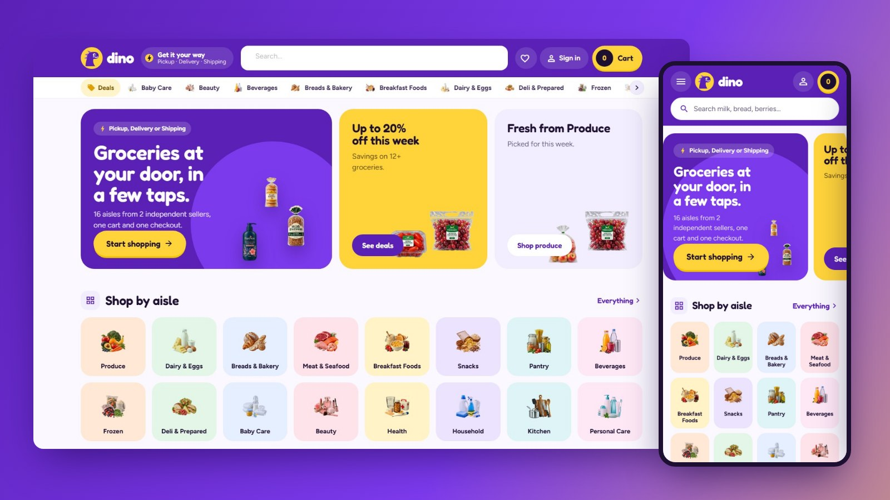

# Dino Market

**Dino Market** is a custom storefront **Layout** for Selldone shops: a multi-vendor grocery marketplace dressed as a purple quick-delivery app: a violet bar with a delivery pill and a yellow cart pill showing the total, swipeable promo cards, the aisles as a tile grid, app cards with a round yellow + on the picture, an aisle column beside every listing, a rounded cart sheet with a free-shipping bar, a violet seller banner and a friendly dinosaur on About, sign-in and the 404. It runs on **[dino.selldone.shop](https://dino.selldone.shop)**, a second address of the shop molino, whose main address carries [Molino Market Hall](https://github.com/selldone-custom-layouts/official-molino): one shop, one Layout per domain (see [Go Live](Go-Live)). It is built on the official [selldone/storefront](https://github.com/selldone/storefront), so Selldone's basket, checkout, payments, vendor offers and orders keep working underneath a completely new design.

## Start here

| I want to… | Page |
| --- | --- |
| Have an AI agent set it up on my shop | **[Install with AI](Install-with-AI)** |
| Set it up myself | [Manual Setup](Manual-Setup) |
| Know what my shop's data needs | [Shop Requirements](Shop-Requirements) |
| Build, upload and verify a release | [Build and Upload](Build-and-Upload) |
| Put it live on my shop and domain | [Go Live](Go-Live) |
| Change colours, fonts, sections, pages | [Customize](Customize) |
| Fix a problem | [Troubleshooting](Troubleshooting) |

## How a Selldone Layout works (one minute)

1. A **Layout** is a complete storefront app (Vue 3) that runs on Selldone's own servers instead of the default storefront.
2. You build it, zip it, and **upload** it to your Selldone developer account with the official [selldone-cli](https://github.com/selldone/cli). Each upload is a new **version**.
3. You **attach** a version to your shop: shop dashboard › Domains › Default layout › Change layout. Every domain of the shop can inherit it.
4. Selldone injects **your** shop into the Layout: its products, categories, sellers, prices, theme, languages and settings. Nothing about molino is hard-coded.

## What you get

- **Home:** rounded promo cards (the shop's promise on violet, this week's savings on yellow, the fresh aisle on lavender), the aisles as a tile grid, today's deals with a countdown to midnight, the fresh aisle, the sellers as round avatars, top picks, and how the order reaches you.
- **Cards:** a lavender square with the packshot large, a yellow saving pill, and a round yellow "+" on the picture that turns into "− n +" in place; "Options" for products with sizes; the seller is named on every card.
- **Shop pages:** a sticky column with every aisle and its icon, then the filters built from product specs; the aisle's banner with its icon; on a phone the aisles become a row of icon tiles.
- **Product page:** a rounded picture stage, the delivery methods and the sellers as rounded choice cards, a big yellow "Add to cart", pill tabs for the details.
- **Seller storefronts:** a violet banner with the seller's mark, live numbers and their aisles as chips.
- **Cart and checkout:** the cart as a rounded sheet from the right on every screen with a free-shipping progress bar, a checkout with step chips, a map-first address sheet and delivery choices.
- **Orders:** the receipt, delivery, the trip and chat.
- **Buyer account:** a violet banner with the sections as pills, pastel tiles.
- **Content pages:** journal, article, About (with the dinosaur and the shop's live numbers), Terms and Privacy, a friendly 404.

## Links

- Live shop: <https://dino.selldone.shop>
- Repository: <https://github.com/selldone-custom-layouts/official-dino>
- Design notes and release log: [`KALIO.md`](https://github.com/selldone-custom-layouts/official-dino/blob/main/KALIO.md)
- All official custom Layouts: <https://github.com/selldone-custom-layouts>
- Selldone: <https://selldone.com>
